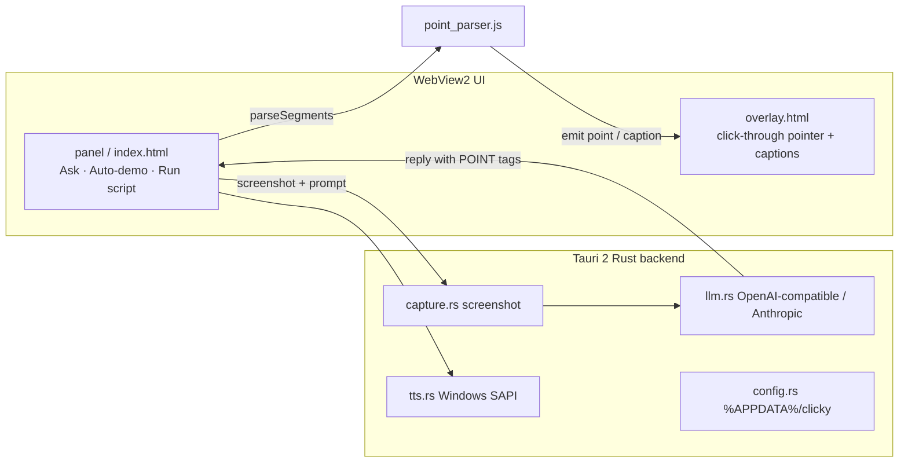

<div align="center">

# Clicky for Windows (Win-Clicky)

### An AI buddy that lives next to your cursor — sees your screen, talks, and **points**

*Windows port of the [farzaa/clicky](https://github.com/farzaa/clicky) idea, rebuilt on **Tauri 2 (Rust + web UI)** with a swappable LLM and no paid voice key required.*


</div>

---

## Problem

Hackathon demos and onboarding walkthroughs need a presenter that can **look at the screen, speak, and point** — without recording a brittle video. macOS Clicky does this in Swift; Windows needed a native port with a swappable LLM (OpenAI / Groq / OpenRouter / Ollama) and free local TTS/STT.

## Architecture



**Design decisions / trade-offs**

| Decision | Why | Trade-off |
|---|---|---|
| Tauri 2 instead of Electron | Small binary, Rust for capture/LLM, WebView2 already on Win10/11 | Linux/macOS are secondary; full GUI CI needs Windows runners |
| `[POINT:x,y:label]` tags in the LLM reply | One round-trip; model chooses targets; overlay is dumb | Needs a vision model (or a fixed-coordinate demo script) |
| Swappable OpenAI-compatible client | Local Ollama demos with no key; swap to GPT-4o for quality | Vision quality varies wildly by provider |
| Shared `point_parser.js` + Rust twin crate | Same regex semantics tested in Node and `cargo test` without linking Tauri | Full `cargo tauri build` still needs MSVC on Windows |

---

## Results (measured, offline)

The GUI cannot run on this Linux CI box (WebView2 / Windows SAPI). What **is** measured here is the pure POINT-tag parser and demo-script validator — the piece that turns LLM text into overlay commands.

| Metric | Value | How |
|---|---|---|
| POINT extraction P / R / F1 | **1.00 / 1.00 / 1.00** | 5 golden replies in `eval/fixtures/golden_replies.json` |
| Invalid coordinate detection | **1 / 1** | OOB tags marked `valid: false` |
| Demo script validation | **2 / 2 pass** | `demo-scripts/*.json` |
| Node tests | **5 / 5 pass** | `node --test tests/point_parser.test.mjs` |
| Rust unit tests (`crates/point_parser`) | **2 / 2 pass** | `cargo test --manifest-path crates/point_parser/Cargo.toml` |

Reproduce:

```bash
node --test tests/point_parser.test.mjs
node eval/run_eval.mjs
cargo test --manifest-path crates/point_parser/Cargo.toml
```

End-to-end “LLM points at the right UI element” accuracy is **TBD** — needs a Windows machine, a vision model key, and a labelled screenshot set. The harness above is the regression gate for the parser contract the LLM is prompted to obey.

---

## Quickstart (Windows 10/11)

```powershell
# deps: rustup, VS C++ build tools, WebView2, tauri-cli ^2
cargo install tauri-cli --version "^2.0"
cargo tauri dev
```

Configure the LLM via the ⚙ gear (OpenAI / Groq / OpenRouter / Ollama). See the original setup notes below for voice and demo scripts.

### Offline tests (any OS with Node 18+ / Rust)

```bash
node --test tests/point_parser.test.mjs
node eval/run_eval.mjs
cargo test --manifest-path crates/point_parser/Cargo.toml
```

### CI

Template: [`ci/github-actions.yml`](ci/github-actions.yml) — copy to `.github/workflows/ci.yml` (OAuth tokens without `workflow` scope cannot push under `.github/workflows/`).

---

## Demo scripts

- [`demo-scripts/sample-demo.json`](demo-scripts/sample-demo.json) — narrated walkthrough with `find` hints
- [`demo-scripts/fixed-coordinates-demo.json`](demo-scripts/fixed-coordinates-demo.json) — explicit `point: {x,y}` (no vision required)

---

## Tech stack

Tauri 2 · Rust · WebView2 · OpenAI-compatible / Anthropic LLM · Windows SAPI TTS · Web Speech API STT · xcap screenshots

---

## License

See repository. Idea inspired by farzaa/clicky (macOS).
